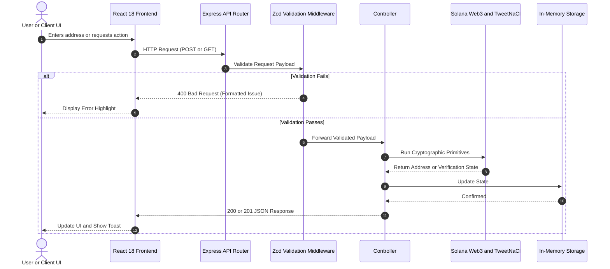
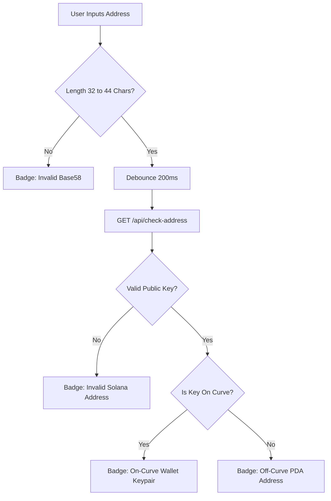
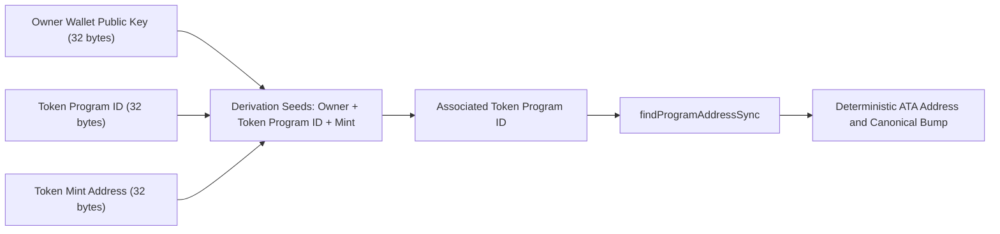
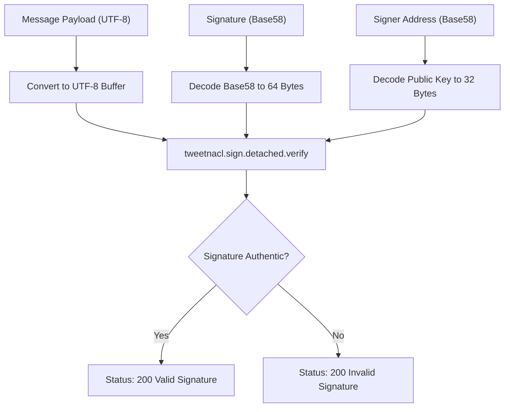

# Solana Address Book & Cryptographic Registry

A fullstack Solana address book and cryptographic workbench. Built with a decoupled **Express 5 + TypeScript** API backend powered by `@solana/web3.js` and a **React 18 + Vite** frontend designed with **Impeccable** craft principles and **Emil Kowalski-inspired** tactile micro-interactions.

---

## 🧭 Architectural Approach

The system is designed with a strict separation of concerns across cryptographic primitives, API routing, data validation, and reactive UI state:

1. **Deterministic Cryptographic Primitives**:
   - **Curve Verification**: Differentiates standard wallet keypairs (which lie on the Ed25519 elliptic curve) from Program Derived Addresses (PDAs, which intentionally fall *off* the curve) using `PublicKey.isOnCurve()`.
   - **Canonical ATA Derivation**: Implements the official Solana SPL Associated Token Account specification using `findProgramAddressSync` with seeds `[ownerPublicKey, TOKEN_PROGRAM_ID, mintPublicKey]`.
   - **Flexible PDA Engine**: Accepts both UTF-8 string seeds and 32-byte Base58 decoded public key buffers, enforcing the Solana runtime's 32-byte per-seed limit.
   - **Dual-Mode Signature Verification**: Uses `tweetnacl` to verify detached Ed25519 signatures, supporting both raw UTF-8 strings and standard **Solana Off-Chain Message Framing** (`\xffsolana offchain...`).

2. **Backend Robustness (Express 5 + Zod)**:
   - Every input payload is strictly typed and parsed with **Zod** schemas before reaching controller handlers.
   - Custom error formatters return clean, user-friendly validation messages.
   - Express 5 compatibility layer handles static SPA asset serving without breaking `path-to-regexp` v8 parameter conventions.

3. **Security Architecture & Hardening**:
   - **Multi-Tiered Rate Limiting**: Zero-dependency sliding window rate limiter protects endpoints against volumetric DDoS and CPU-intensive cryptographic derivations.
   - **Capacity Guarding (DoS Defense)**: Enforces an in-memory limit of 500 contacts to prevent Out-of-Memory heap crashes from automated script floods.
   - **Solana Runtime Bounds**: Enforces runtime constraints of at most 16 seeds and 32 bytes per seed on PDA derivations.
   - **Payload & CORS Boundaries**: Request bodies are capped at 16KB with origin-restricted CORS allowlists.

4. **Frontend Craft & Ergonomics (Emil Kowalski & Impeccable)**:
   - **Operate Mode**: High visual density, scannable tabular typography, and dark-mode palette (`#09090b` canvas, `#18181c` surfaces).
   - **Live Address Feedback**: Real-time debounced address analyzer that displays whether an address is an on-curve wallet or an off-curve PDA *as the user types*.
   - **Tactile Micro-Interactions**: Active press scaling (`transform: scale(0.97)`), copy-to-clipboard morphing checkmarks, quick ATA derivation chips, and floating toast notifications.

---

## 🔄 System Flows & Lifecycles

### 1. Overall System Architecture & Request Lifecycle



---

### 2. Live On-Curve vs. Off-Curve Address Classification Flow



---

### 3. Associated Token Account (ATA) Derivation Flow



---

### 4. Cryptographic Ed25519 Signature Verification Flow



---

## 🏗 Directory Structure

```text
solana-address-book/
├── backend/                         # Dedicated Express 5 API Server
│   ├── src/
│   │   ├── controllers/
│   │   │   ├── contactController.ts # Contact directory CRUD & ATA derivation
│   │   │   └── cryptoController.ts  # Signature verification & PDA calculator
│   │   ├── middleware/
│   │   │   ├── rateLimiter.ts       # Zero-dependency sliding window rate limiters
│   │   │   └── validation.ts        # Zod request validation schemas
│   │   ├── routes/
│   │   │   └── api.ts               # Express 5 API route declarations
│   │   ├── services/
│   │   │   └── contactService.ts    # In-memory storage & address uniqueness
│   │   ├── types/
│   │   │   └── index.ts             # Backend TypeScript interfaces
│   │   ├── utils/
│   │   │   └── solana.ts            # @solana/web3.js & tweetnacl utilities
│   │   └── index.ts                 # Express entry point & static SPA fallback
│   ├── .env                         # Server environment variables
│   ├── .env.example
│   ├── .gitignore
│   ├── tsconfig.json
│   └── package.json
│
├── frontend/                        # React 18 + Vite Frontend Application
│   ├── src/
│   │   ├── components/
│   │   │   ├── Header.tsx           # App header, brand mark & tab switcher
│   │   │   ├── ContactList.tsx      # Directory view, search filter & empty states
│   │   │   ├── ContactCard.tsx      # Contact item with copy & quick actions
│   │   │   ├── AddContactModal.tsx  # Add address dialog with live curve badge
│   │   │   ├── EditContactModal.tsx # Update contact label dialog
│   │   │   ├── AtaDeriver.tsx       # ATA calculation tool with quick presets
│   │   │   ├── VerifySignature.tsx  # Ed25519 signature verifier with sample loader
│   │   │   ├── PdaCalculator.tsx    # Multi-seed PDA explorer with dynamic rows
│   │   │   └── Toast.tsx            # Fluid notification toast stack
│   │   ├── hooks/
│   │   │   └── useContacts.ts       # React state & API client hook
│   │   ├── lib/
│   │   │   └── api.ts               # Configurable API client (VITE_API_BASE_URL)
│   │   ├── types/
│   │   │   └── index.ts             # Domain models
│   │   ├── App.tsx                  # Root layout & tab router
│   │   ├── main.tsx                 # React DOM mount point
│   │   ├── vite-env.d.ts            # Client environment variable type declarations
│   │   └── styles.css               # Design system & interaction tokens
│   ├── public/
│   │   └── favicon.svg
│   ├── .env                         # Client environment variables
│   ├── .env.example
│   ├── .gitignore
│   ├── index.html                   # HTML entry point
│   ├── vercel.json                  # Vercel SPA routing configuration
│   ├── vite.config.ts               # Vite proxy config
│   ├── tsconfig.json
│   └── package.json
│
├── .env                             # Workspace root environment file
├── .env.example
├── .gitignore
└── README.md                        # Documentation
```

---

## 🛠 Core Solana Implementation Details

### 1. Associated Token Account (ATA) Derivation
```typescript
export function deriveATA(ownerAddress: string, mintAddress: string): string {
  const ownerPubkey = new PublicKey(ownerAddress);
  const mintPubkey = new PublicKey(mintAddress);

  const [ata] = PublicKey.findProgramAddressSync(
    [
      ownerPubkey.toBuffer(),
      TOKEN_PROGRAM.toBuffer(),
      mintPubkey.toBuffer(),
    ],
    ASSOCIATED_TOKEN_PROGRAM
  );

  return ata.toBase58();
}
```

### 2. Dynamic Seed PDA Derivation (Pubkey + UTF-8 Support)
```typescript
export function derivePDA(programId: string, seeds: string[]): { pda: string; bump: number } {
  const programPubkey = new PublicKey(programId);

  const seedBuffers = seeds.map(seed => {
    // If the seed is a 32-byte Base58 pubkey, use its decoded binary representation
    if (isValidSolanaAddress(seed)) {
      try {
        return new PublicKey(seed).toBuffer();
      } catch {}
    }
    const buffer = Buffer.from(seed, 'utf8');
    if (buffer.length > 32) {
      throw new Error(`Seed "${seed}" exceeds 32 bytes limit`);
    }
    return buffer;
  });

  const [pda, bump] = PublicKey.findProgramAddressSync(seedBuffers, programPubkey);
  return { pda: pda.toBase58(), bump };
}
```

---

## 📡 API Endpoints Reference

### Contacts Directory
| Method | Endpoint | Rate Limit | Description | Sample Request | Sample Response |
| :--- | :--- | :--- | :--- | :--- | :--- |
| `POST` | `/api/contacts` | 30 / min | Register new contact with on/off-curve detection | `{"name":"Cold Storage","address":"7YttH9..."}` | `{"id":1,"name":"Cold Storage","address":"7YttH9...","type":"wallet"}` |
| `GET` | `/api/contacts` | 300 / 15m | Retrieve contacts (optional `?type=wallet` or `?type=pda`) | — | `[{"id":1,"name":"Cold Storage",...}]` |
| `GET` | `/api/contacts/:id` | 300 / 15m | Fetch specific contact by integer ID | — | `{"id":1,"name":"Cold Storage",...}` |
| `PUT` | `/api/contacts/:id` | 30 / min | Update contact label | `{"name":"Treasury Primary"}` | `{"id":1,"name":"Treasury Primary",...}` |
| `DELETE` | `/api/contacts/:id` | 30 / min | Remove contact from directory | — | `{"message":"Contact deleted","id":1}` |

### Cryptographic & Utility Tools
| Method | Endpoint | Rate Limit | Description | Sample Request | Sample Response |
| :--- | :--- | :--- | :--- | :--- | :--- |
| `POST` | `/api/contacts/:id/derive-ata` | 60 / min | Derive ATA for contact + token mint | `{"mintAddress":"EPjFWdd5..."}` | `{"ata":"4zMMC...","owner":"7Ytt...","mint":"EPjFW..."}` |
| `POST` | `/api/verify-ownership` | 60 / min | Verify detached Ed25519 signature | `{"address":"9WzD...","message":"Auth","signature":"3X5i..."}` | `{"valid":true,"verifiedAt":"2026-..."}` |
| `POST` | `/api/derive-pda` | 60 / min | Derive custom PDA & canonical bump | `{"programId":"1111...","seeds":["vault","7Ytt..."]}` | `{"pda":"Gh9Z...","bump":255,"isOffCurve":true}` |
| `GET` | `/api/check-address` | 300 / 15m | Live address verification & curve state | `?address=7YttH9...` | `{"valid":true,"type":"wallet","isOnCurve":true}` |

---

## 🚀 Deployment Guide (Deploying Separately)

### 1. Deploy Frontend (Vercel)
1. Import your Git repository into **Vercel**.
2. Set **Root Directory** to `frontend`.
3. Vercel automatically detects **Vite**:
   - Build Command: `npm run build`
   - Output Directory: `dist`
4. In **Environment Variables**, add:
   - `VITE_API_BASE_URL`: `https://your-backend-domain.com/api`
   - `VITE_SOLANA_NETWORK`: `devnet`
   - `VITE_SOLANA_RPC_URL`: `https://api.devnet.solana.com`
5. Click **Deploy**. SPA rewrites are already handled by [`frontend/vercel.json`](file:///c:/Users/USER/Desktop/100xBootcamp/Web-3/Projects/solana-address-book/frontend/vercel.json).

### 2. Deploy Backend (Render, Railway, Fly.io, or VPS)
1. Set **Root Directory** to `backend`.
2. Configure build & start commands:
   - Build Command: `npm install`
   - Start Command: `npm start` (runs `tsx src/index.ts`)
3. Set **Environment Variables**:
   - `PORT`: `3000` (or host assigned port)
   - `NODE_ENV`: `production`
   - `FRONTEND_URL`: `https://your-frontend.vercel.app`
   - `SOLANA_NETWORK`: `devnet`
   - `SOLANA_RPC_URL`: `https://api.devnet.solana.com`
4. The backend automatically accepts requests from `FRONTEND_URL` and all `*.vercel.app` preview deployments.
