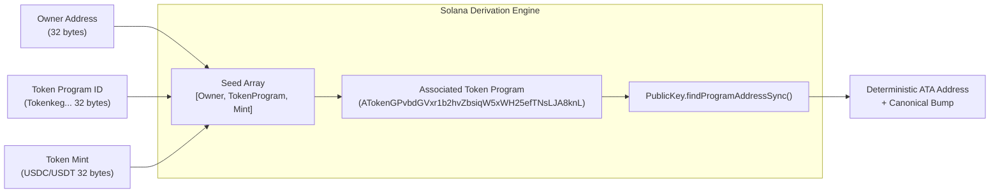
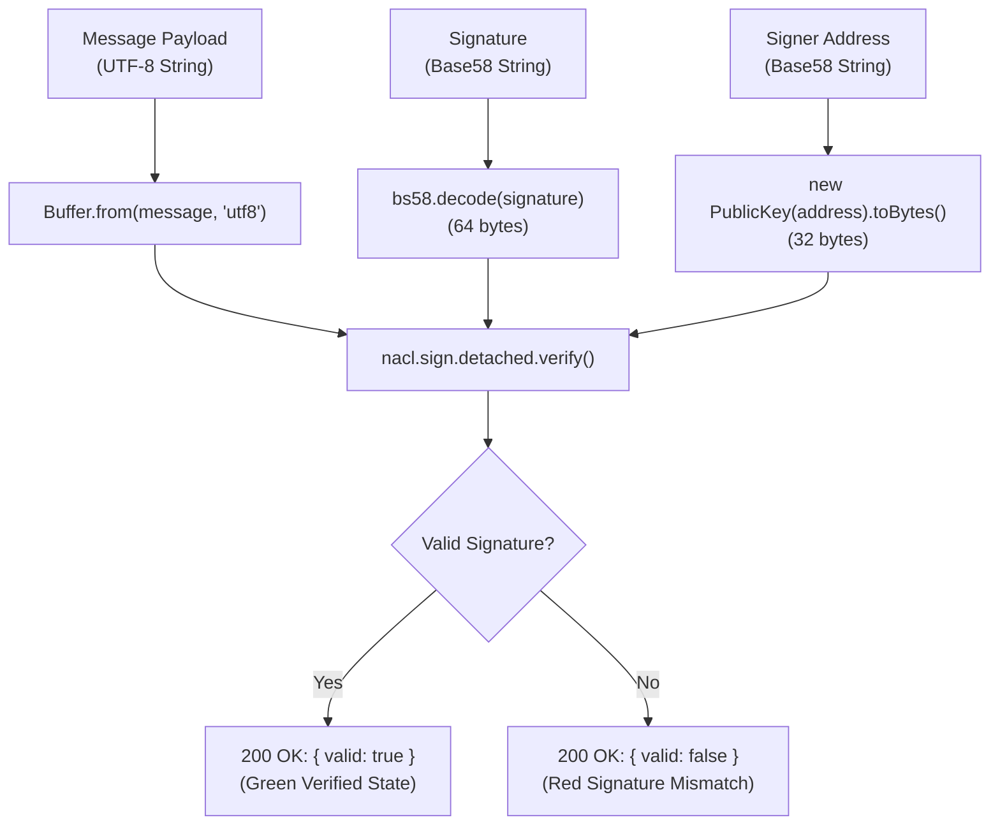

# Solana Address Book API

A comprehensive backend service built with TypeScript and Express.js for managing a Solana address book and providing essential cryptographic utilities for the Solana blockchain.

## 🏗 Project Structure

The project follows a standard layered architecture to ensure separation of concerns and maintainability.

```text
solana-address-book/
├── src/
│   ├── controllers/      # Request handlers (Contact & Crypto logic)
│   ├── middleware/       # Zod validation and error handling
│   ├── routes/           # API route definitions
│   ├── services/         # Business logic (In-memory contact storage)
│   ├── utils/            # Solana-specific utility functions
│   ├── types/            # TypeScript interface definitions
│   └── index.ts          # Application entry point
├── .env                  # Environment variables
├── tsconfig.json         # TypeScript configuration
└── package.json          # Dependencies and scripts
```

## 🔄 Logic & Workflow

The API processes requests through a request-response cycle involving validation, control, and service layers.

### Request Flow Diagram

```mermaid
graph TD
    A[Client Request] --> B{Middleware}
    B -->|Zod Validation| C[Controller]
    B -->|Invalid| D[400 Bad Request]
    
    C --> E[Service Layer]
    C --> F[Solana Utils]
    
    E -->|In-memory Storage| G[Contact Data]
    F -->|@solana/web3.js| H[Solana Network Info]
    
    G --> I[Controller]
    H --> I
    
    I --> J[JSON Response]
```

---

### 3. Associated Token Account (ATA) Derivation Flow



---

### 4. Cryptographic Ed25519 Signature Verification Flow



---

## 🏗 Directory Structure

```text
solana-address-book/
├── backend/                         # Dedicated Express 5 API Server
│   ├── src/
│   │   ├── controllers/
│   │   │   ├── contactController.ts # Contact directory CRUD & ATA derivation
│   │   │   └── cryptoController.ts  # Signature verification & PDA calculator
│   │   ├── middleware/
│   │   │   └── validation.ts        # Zod request validation schemas
│   │   ├── routes/
│   │   │   └── api.ts               # Express 5 API route declarations
│   │   ├── services/
│   │   │   └── contactService.ts    # In-memory storage & address uniqueness
│   │   ├── types/
│   │   │   └── index.ts             # Backend TypeScript interfaces
│   │   ├── utils/
│   │   │   └── solana.ts            # @solana/web3.js & tweetnacl utilities
│   │   └── index.ts                 # Express entry point & static SPA fallback
│   ├── tsconfig.json
│   └── package.json
│
├── frontend/                        # React 18 + Vite Frontend Application
│   ├── src/
│   │   ├── components/
│   │   │   ├── Header.tsx           # App header, brand mark & tab switcher
│   │   │   ├── ContactList.tsx      # Directory view, search filter & empty states
│   │   │   ├── ContactCard.tsx      # Contact item with copy & quick actions
│   │   │   ├── AddContactModal.tsx  # Add address dialog with live curve badge
│   │   │   ├── EditContactModal.tsx # Update contact label dialog
│   │   │   ├── AtaDeriver.tsx       # ATA calculation tool with quick presets
│   │   │   ├── VerifySignature.tsx  # Ed25519 signature verifier with sample loader
│   │   │   ├── PdaCalculator.tsx    # Multi-seed PDA explorer with dynamic rows
│   │   │   └── Toast.tsx            # Fluid notification toast stack
│   │   ├── hooks/
│   │   │   └── useContacts.ts       # React state & API client hook
│   │   ├── types/
│   │   │   └── index.ts             # Domain models
│   │   ├── App.tsx                  # Root layout & tab router
│   │   ├── main.tsx                 # React DOM mount point
│   │   └── styles.css               # Design system & interaction tokens
│   ├── public/
│   │   └── favicon.svg
│   ├── index.html                   # HTML entry point
│   ├── vite.config.ts               # Vite proxy config
│   ├── tsconfig.json
│   └── package.json
│
├── public/                          # Server-side static fallback UI
└── README.md                        # Documentation
```

---

## 🛠 Core Solana Implementation Details

### 1. Associated Token Account (ATA) Derivation
```typescript
export function deriveATA(ownerAddress: string, mintAddress: string): string {
  const ownerPubkey = new PublicKey(ownerAddress);
  const mintPubkey = new PublicKey(mintAddress);

  const [ata] = PublicKey.findProgramAddressSync(
    [
      ownerPubkey.toBuffer(),
      TOKEN_PROGRAM.toBuffer(),
      mintPubkey.toBuffer(),
    ],
    ASSOCIATED_TOKEN_PROGRAM
  );

  return ata.toBase58();
}
```

### 2. Dynamic Seed PDA Derivation (Pubkey + UTF-8 Support)
```typescript
export function derivePDA(programId: string, seeds: string[]): { pda: string; bump: number } {
  const programPubkey = new PublicKey(programId);

  const seedBuffers = seeds.map(seed => {
    // If the seed is a 32-byte Base58 pubkey, use its decoded binary representation
    if (isValidSolanaAddress(seed)) {
      try {
        return new PublicKey(seed).toBuffer();
      } catch {}
    }
    const buffer = Buffer.from(seed, 'utf8');
    if (buffer.length > 32) {
      throw new Error(`Seed "${seed}" exceeds 32 bytes limit`);
    }
    return buffer;
  });

  const [pda, bump] = PublicKey.findProgramAddressSync(seedBuffers, programPubkey);
  return { pda: pda.toBase58(), bump };
}
```

---

## 📡 API Endpoints Reference

### Contacts Directory
| Method | Endpoint | Description | Sample Request | Sample Response |
| :--- | :--- | :--- | :--- | :--- |
| `POST` | `/api/contacts` | Register a new contact with automatic on/off-curve detection | `{"name":"Cold Storage","address":"7YttH9..."}` | `{"id":1,"name":"Cold Storage","address":"7YttH9...","type":"wallet"}` |
| `GET` | `/api/contacts` | Retrieve contacts (optional `?type=wallet` or `?type=pda`) | — | `[{"id":1,"name":"Cold Storage",...}]` |
| `GET` | `/api/contacts/:id` | Fetch specific contact by integer ID | — | `{"id":1,"name":"Cold Storage",...}` |
| `PUT` | `/api/contacts/:id` | Update contact label | `{"name":"Treasury Primary"}` | `{"id":1,"name":"Treasury Primary",...}` |
| `DELETE` | `/api/contacts/:id` | Remove contact from directory | — | `{"message":"Contact deleted","id":1}` |

### Cryptographic & Utility Tools
| Method | Endpoint | Description | Sample Request | Sample Response |
| :--- | :--- | :--- | :--- | :--- |
| `POST` | `/api/contacts/:id/derive-ata` | Derive ATA for contact + token mint | `{"mintAddress":"EPjFWdd5..."}` | `{"ata":"4zMMC...","owner":"7Ytt...","mint":"EPjFW..."}` |
| `POST` | `/api/verify-ownership` | Verify detached Ed25519 signature | `{"address":"9WzD...","message":"Auth","signature":"3X5i..."}` | `{"valid":true,"verifiedAt":"2026-..."}` |
| `POST` | `/api/derive-pda` | Derive custom PDA & canonical bump | `{"programId":"1111...","seeds":["vault","7Ytt..."]}` | `{"pda":"Gh9Z...","bump":255,"isOffCurve":true}` |
| `GET` | `/api/check-address` | Live address verification & curve state | `?address=7YttH9...` | `{"valid":true,"type":"wallet","isOnCurve":true}` |

---

## 🚀 Getting Started

### Prerequisites
- **Node.js**: v18.0.0 or higher
- **npm**: v9.0.0 or higher

### Option 1: Unified Dev Server (Backend + UI)
```bash
# In solana-address-book root directory:
npm install
npm run dev
```
Open **`http://localhost:3000`** in your browser.

### Option 2: Fullstack with Vite HMR (Recommended for Frontend Work)
```bash
# Terminal 1 - Backend Server:
npm run dev

# Terminal 2 - React Frontend:
cd frontend
npm install
npm run dev
```
Open **`http://localhost:5173`** for Vite hot module replacement (API calls are automatically proxied to port 3000).
